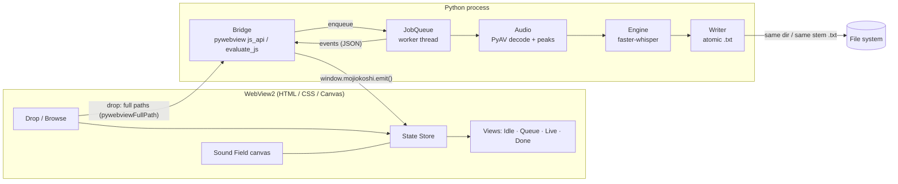
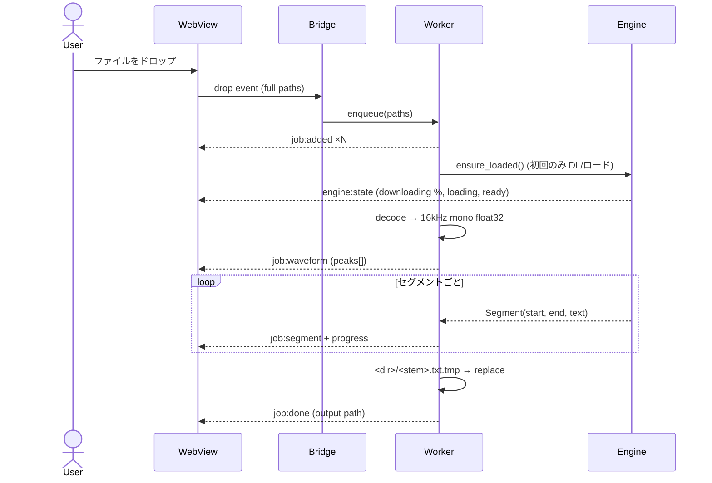
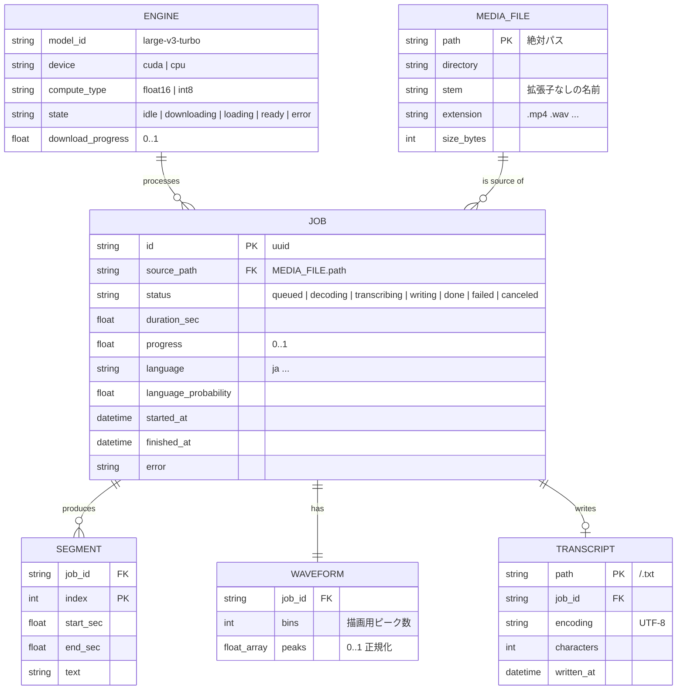
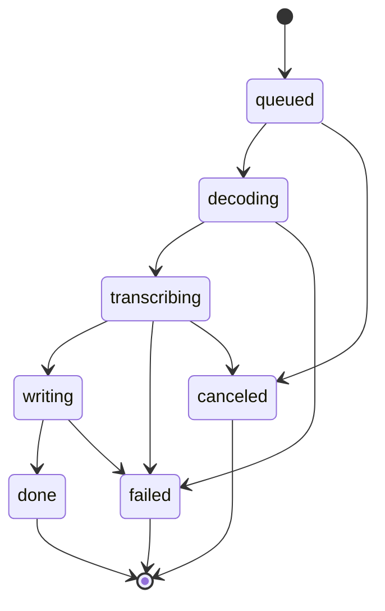

# mojiokoshi — 設計書

> 音声・動画ファイルをウィンドウへドラッグ&ドロップすると、同じフォルダに同じ名前の `.txt` として文字起こしを書き出すデスクトップアプリ。

---

## 1. リサーチ

### 1.1 前提となる制約

| 論点 | 調査結果 | 設計への影響 |
| --- | --- | --- |
| 「同じフォルダに書き出す」 | ブラウザ（純Webアプリ）はドロップされたファイルの**絶対パスを取得できず**、任意フォルダへの書き込みもできない（File System Access API でも親ディレクトリのハンドルは得られない） | **デスクトップアプリ**にする必要がある |
| 実行環境 | Windows 11 / RTX 4060 Laptop (8 GB VRAM) / CUDA Driver 13.2 / Python 3.13 / Node 24 / ffmpeg 8 | GPU推論が現実的。Python中心で組める |
| 入力 | テスト素材は日本語講義の mp4（約46分 / 140〜195 MB） | 長尺・日本語・動画コンテナへの対応が必須 |

### 1.2 音声認識エンジンの比較

| 候補 | 速度 | 日本語精度 | オフライン | コスト | 評価 |
| --- | --- | --- | --- | --- | --- |
| OpenAI Whisper（PyTorch 公式） | 遅い | 高 | ○ | 無料 | PyTorch + CUDA 版が重い（数GB） |
| **faster-whisper（CTranslate2）** | **公式比 最大4倍、省メモリ** | 高（Whisper と同じ重み） | ○ | 無料 | **採用**。fp16/int8 量子化、Silero VAD 内蔵、PyAV 同梱で ffmpeg 不要 |
| whisper.cpp | 速い | 高 | ○ | 無料 | Python から使うにはバインディングが必要 |
| kotoba-whisper v2.0 | large-v3 比 6.3倍 | 日本語特化で高 | ○ | 無料 | 日本語専用（他言語不可）。faster-whisper 形式もありオプション候補 |
| ReazonSpeech (NeMo) | 速い | 高 | ○ | 無料 | NeMo 依存が重い |
| クラウド API（OpenAI 等） | 速い | 高 | × | 従量課金 | APIキー管理・音声の外部送信が必要 |

**モデル:** `large-v3-turbo`（デコーダ層を 32→4 に削減した large-v3 派生。多言語・自動言語判定のまま large-v3 に近い精度で大幅に高速）。
日本語のみで使う場合の選択肢として `kotoba-tech/kotoba-whisper-v2.0-faster` を CLI オプションで差し替え可能にする。

**ハルシネーション対策:**
- `vad_filter=True`（Silero VAD）で無音区間を除外 → 無音部の「ご視聴ありがとうございました」系の幻聴を抑制
- `condition_on_previous_text=False` → 長尺での同一フレーズ反復ループを抑制

**GPU:** CTranslate2 4.x は CUDA 12 + cuDNN 9 を要求。Windows ではシステムに CUDA Toolkit を入れず、pip の `nvidia-cublas-cu12` / `nvidia-cudnn-cu12` に含まれる DLL を `os.add_dll_directory` で解決する。GPU が使えない環境では自動で CPU (int8) にフォールバック。

### 1.3 デスクトップ UI 基盤の比較

| 候補 | 表現力 | 配布サイズ | D&D でフルパス取得 | 評価 |
| --- | --- | --- | --- | --- |
| Tkinter + tkinterdnd2 | 低 | 小 | ○ | 受賞水準のビジュアル表現は困難 |
| PySide6 (Qt) | 中 | 大 | ○ | CSS/Canvas 的な表現の自由度が足りない |
| Electron | 高 | 大 (150MB+) | ○ | Node ↔ Python のプロセス間連携が必要 |
| Tauri | 高 | 小 | ○ | Rust ツールチェーンが必要 |
| **pywebview** | **高（HTML/CSS/Canvas）** | **小（Windows 11 標準の WebView2 を利用）** | **○ `pywebviewFullPath`** | **採用**。Python から直接エンジンを呼べ、UI は Web 技術で作り込める |

pywebview は DOM の `drop` イベントを Python 側で購読すると、各ファイルの絶対パスを `domTransfer.files[i].pywebviewFullPath` として受け取れる。

### 1.4 ビジュアル・リサーチ（Awwwards / FWA / Webby 受賞作の傾向）

- **エディトリアル・タイポグラフィ**：巨大なセリフ見出し × 細いモノスペースのメタ情報という強いコントラスト
- **シグネチャー・インタラクション**：そのサイトでしか見られない 1 つの「動き」が記憶に残る（例：入力に反応する生成的ビジュアル）
- **抑制された配色**：ほぼモノクロ + 1色のアクセント
- **状態遷移の連続性**：画面を「切り替える」のではなく、要素が「変形」して次の状態になる
- **質感**：フィルムグレイン、サブピクセルの罫線、tabular numerals
- **アクセシビリティとパフォーマンス**：`prefers-reduced-motion` 対応、60fps、キーボード操作

---

## 2. コンセプト

**「音を落とすと、言葉が残る。」— Drop sound, keep words.**

- ウィンドウ全体が**音の場（Sound Field）**。何十本もの水平線がノイズで揺らぎ、カーソルに反応して膨らむ。
- ファイルをドラッグすると線が中央へ収束して振幅が増し、「受け止める」構えになる。
- ドロップすると線は 1 本に**収束**し、そのファイル**本物の波形**へと変形する。波形は文字起こしの進行に合わせて朱色で塗られていく。
- 起こされた言葉は下から一行ずつ、ぼかしから焦点が合うように現れる。古い行は紙の奥へ沈むように薄れていく。

配色は「墨・紙・朱」。

| Token | Dark | Light | 用途 |
| --- | --- | --- | --- |
| `--ink` | `#0c0c0d` | `#f1eee6` | 背景 |
| `--paper` | `#ece8df` | `#141414` | 本文 |
| `--shu` | `#ff4a1c` | `#e0360e` | 唯一のアクセント（朱） |
| `--mute` | paper 56% | ink 56% | メタ情報 |
| `--line` | paper 12% | ink 14% | 罫線 |

書体：見出し **Instrument Serif**／UI **Geist**／数値・パス **Geist Mono**／日本語本文 **Shippori Mincho**（すべてローカル同梱、オフライン動作）。

---

## 3. アーキテクチャ



### 3.1 モジュール構成

```
mojiokoshi/
├─ mojiokoshi/              Python パッケージ
│  ├─ __main__.py           エントリ（引数あり→CLI / なし→GUI）
│  ├─ cuda.py               pip 版 CUDA DLL の解決
│  ├─ engine.py             モデルの取得・ロード・推論（GPU→CPU フォールバック）
│  ├─ media.py              対応拡張子、デコード、波形ピーク計算
│  ├─ jobs.py               ドメインモデル（Job / Segment）と直列ワーカー
│  ├─ writer.py             テキスト整形と原子的書き込み
│  ├─ gui.py                pywebview ブリッジ
│  ├─ cli.py                コマンドライン
│  └─ web/                  index.html / app.css / app.js / fonts
├─ docs/DESIGN.md
├─ requirements.txt
├─ setup.bat                初回セットアップ
└─ mojiokoshi.bat           起動
```

### 3.2 処理シーケンス



---

## 4. ER 図（ドメインモデル）

アプリは DB を持たず、以下のエンティティをメモリ上で扱う。永続化されるのは `TRANSCRIPT`（.txt ファイル）のみ。



### 4.1 Job の状態遷移



---

## 5. 機能仕様

| ID | 要件 |
| --- | --- |
| F1 | 音声・動画ファイル（複数可）またはフォルダをウィンドウ全体にドロップできる。フォルダは直下の対応ファイルを展開 |
| F2 | 出力先は入力と**同じフォルダ・同じファイル名**の `.txt`（UTF-8、1セグメント1行）。既存ファイルは上書き。`.tmp` に書いてから置換するため途中で壊れない |
| F3 | 対応形式：mp4 mov mkv webm avi m4v / wav mp3 m4a aac flac ogg opus wma |
| F4 | 複数ファイルはキューで直列処理。処理中も追加ドロップ可 |
| F5 | 進捗（%・タイムコード・残り時間）、実際の音声波形、リアルタイムの文字起こしを表示 |
| F6 | 処理中ジョブ・待機中ジョブのキャンセル |
| F7 | 完了後「テキストを開く」「フォルダで表示」「コピー」 |
| F8 | クリック（または Ctrl+O）でファイル選択ダイアログ |
| F9 | 初回はモデルを自動ダウンロード（進捗表示）。以降は完全オフライン |
| F10 | CLI：`python -m mojiokoshi a.mp4 b.wav` でも同じ出力 |

非機能：UI はワーカースレッドと分離して常に 60fps／GPU 不可時は CPU 自動フォールバック／音声は外部送信しない／`prefers-reduced-motion`・キーボード操作・`aria-live` 対応。

---

## 6. 画面仕様

| 状態 | 構成 |
| --- | --- |
| **Idle** | 全面に Sound Field。巨大見出し「Drop sound, / keep *words*.」、日本語サブコピー、下部に対応形式とエンジン状態 |
| **Drag over** | 四隅のトンボ（クロップマーク）が内側へ寄り、線が中央へ収束・振幅増大。見出しが「Release.」に切り替わる |
| **Working** | 左：キュー（番号・名前・長さ・状態）。右：ファイル名、言語・デバイス等のメタ、実波形＋朱色の進捗、巨大な％表示、ライブ文字起こし |
| **Done** | 波形が全面朱色に。保存先パス、文字数、所要時間、操作ボタン |
| **Error** | 該当ジョブに理由を表示し、キューは継続 |

---

## 7. 実装中に確定した判断

| 論点 | 検証結果 | 決定 |
| --- | --- | --- |
| 句読点 | プロンプトなしでは日本語が「空白区切り・句読点なし」になる | 先に言語判定し、`ja` / `zh` には句読点付きの `initial_prompt` を与え `condition_on_previous_text=True`。46分の実音声で反復ループなし・句読点安定を確認 |
| デコード | PyAV 19 で faster-whisper 同梱の `decode_audio` が `metadata_errors` 引数エラー | PyAV を直接使う自前デコーダに置換（デコード進捗も取得可能に） |
| モデル DL 進捗 | hf-xet バックエンドは最後にまとめてファイル化するため進捗が取れない | `HF_HUB_DISABLE_XET=1` で通常 HTTP DL にし、キャッシュの増加量を監視 |
| UI 通信 | セグメントごとの `run_js` が UI スレッド完了を同期待ちし、GPU 使用率 13%・8倍速に低下 | 送信キュー + 専用スレッドで 1/30 秒ごとにまとめて送信。ワーカーは一切ブロックしない |
| 波形 | 1時間級の講義では、区間最大値の線形表示がほぼ一様な「壁」になる | 4000 区間の RMS を上位 24dB で 0..1 に写像し、バー中心付近をサンプリング |
| ウィンドウ枠 | WinForms のフレームレス窓は縁リサイズ不可 | ネイティブ枠を残し、DWM でキャプション色を背景色に一致させる（Snap・リサイズも OS 標準） |

---

## 8. 品質セルフチェック基準

各項目を満たすまで改善を繰り返す。

- [x] **Concept** — 音の場（リッジライン）→ ドラッグで朱に高揚 → ドロップで 1 本に収束 → 実波形が左から立ち上がる → 朱で塗られていく → 完了時に光が走る、を 1 本のモーションで接続
- [x] **Typography** — Instrument Serif（見出し・数値）／Geist（UI）／Geist Mono（メタ）／Shippori Mincho（日本語本文）。数値は tabular、見出しは字間 -0.028em
- [x] **Color** — 墨・紙・朱のみ。ダーク／ライト両対応、ネイティブのタイトルバーも同色に塗る。ライトの朱ボタンは白文字でコントラスト確保
- [x] **Motion** — 共通イージング（expo-out）、Canvas は不要時にスリープ、`prefers-reduced-motion` で静止
- [x] **Details** — フィルムグレイン、トンボ、カーソル追従タグ、行末の朱キャレット、波形ホバーでその時点の発言を表示、縦書きアクセント、空状態・失敗（×）・キャンセル・無音の各表示、長いファイル名の省略、専用アイコン
- [x] **Function** — 実ファイル 2 本（46分・約65分）を GUI で連続処理し、同じフォルダに同名 .txt を出力。壊れたファイル／音声なし動画／無音／非対応形式でもキューが止まらないことを確認
- [x] **Performance** — UI へのイベントをバッチ化して GPU 使用率の低下を解消。46分を約2分半（GUI）／約105秒（推論単体）。デモハーネスで 1000×660 〜 1320×860、ダーク／ライトを撮影確認
